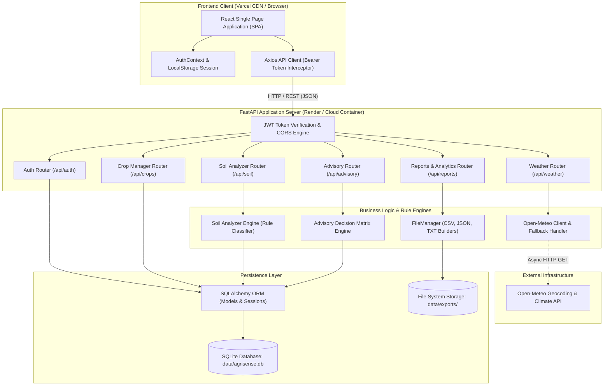
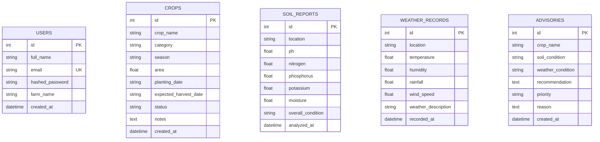
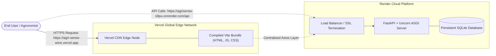

# AGRI SENSE – FARMING ADVISORY SIMULATOR
## Academic Project Report & Technical Documentation

---

## 1. Project Overview & Abstract

### 1.1 Project Title
**AGRI SENSE: A Full-Stack Dynamic Agricultural Management and Rule-Based Advisory Simulation System**

### 1.2 Abstract
Agriculture is progressively shifting toward data-driven methodologies to mitigate the adverse impacts of unpredictable weather, depleted soil nutrients, and suboptimal crop management. **AgriSense** is an enterprise-grade full-stack web application designed to assist farmers, agricultural consultants, and researchers in managing crop lifecycles, evaluating soil fertility, retrieving real-time climate data, and synthesizing scientific rule-based farming advisories. 

Built using a decoupled client-server architecture, AgriSense couples a high-performance **FastAPI (Python 3)** backend with a reactive **React (Vite, JavaScript, Vanilla CSS3)** client. Data persistence is managed via an optimized **SQLite** engine abstracted through **SQLAlchemy ORM**. The platform incorporates a multi-factor decision matrix that correlates crop growth requirements, laboratory soil parameters (pH, Nitrogen, Phosphorus, Potassium, Moisture), and live atmospheric conditions (temperature, humidity, precipitation, wind speed via Open-Meteo APIs) to generate priority-ranked agricultural recommendations. Data portability is facilitated via multi-format export engines producing structured CSV, JSON, and text summaries.

---

## 2. Problem Statement & Motivation

### 2.1 The Problem
Traditional farming practices in developing and agrarian economies frequently encounter severe challenges:
1. **Nutrient Imbalance**: Over-fertilization or unguided application of chemical fertilizers degrades soil health, disrupts pH balance, and inflates operational expenses.
2. **Weather Vulnerability**: Inability to rapidly correlate incoming meteorological changes (e.g., unexpected dry spells or heavy precipitation) with specific crop vulnerabilities leads to preventable crop failure.
3. **Information Disconnect**: Smallholder farmers and field agronomists lack centralized digital record-keeping systems for crop lifecycles, soil test history, and past advisory logs.
4. **Complex Enterprise Solutions**: Existing enterprise agricultural software is cost-prohibitive, bloated, or requires expensive proprietary hardware/sensors.

### 2.2 The AgriSense Solution
AgriSense addresses these challenges by offering:
- A centralized digital portal for full **CRUD (Create, Read, Update, Delete)** management of crop lifecycles.
- An intelligent **rule-based soil diagnostic engine** that analyzes NPK and pH readings, outputting actionable soil amendment guidance (e.g., lime or gypsum application, specific fertilizer supplements).
- An automated **live meteorological client** leveraging free global satellite telemetry without requiring vendor API keys, backed by an offline manual fallback.
- An automated **decision matrix advisory engine** that synthesizes soil, crop, and weather factors into priority-ranked advisories (*High, Medium, Low*).
- An offline-capable, cloud-deployable, lightweight architecture with role-based JWT authentication.

---

## 3. Technology Stack & Architectural Design

### 3.1 Technology Stack Matrix

| Layer | Technology | Version | Purpose / Role |
| :--- | :--- | :--- | :--- |
| **Frontend Framework** | React.js | 18.2.0 | Reactive component-based user interface |
| **Build Tool / Bundler** | Vite | 5.1.6 | Fast development server & optimized production rollup |
| **Styling** | Vanilla CSS3 (Custom Variables) | CSS3 | Responsive agricultural dark/light green theme |
| **Icons & Visuals** | Lucide React | 0.359.0 | Scalable vector interface icons |
| **Data Visualization** | Chart.js & react-chartjs-2 | 4.4.2 / 5.2.0 | Dynamic doughnut & bar distribution charts |
| **HTTP Client** | Axios | 1.6.8 | Centralized API communication layer with token interceptor |
| **Backend Framework** | FastAPI | 0.110+ | Asynchronous RESTful API framework with Swagger OpenAPI |
| **ORM / Database** | SQLAlchemy & SQLite3 | 2.0.28 | Object-Relational Mapping & persistent database |
| **Data Validation** | Pydantic v2 | 2.8.0 | Strict request/response payload validation & schemas |
| **Async HTTP Client** | HTTPX | 0.27.0 | Non-blocking external API client for live weather lookups |
| **Security / Crypto** | Python Standard (`hashlib`, `hmac`) | Python 3.11+ | PBKDF2-HMAC-SHA256 password hashing & signed tokens |
| **Hosting (Frontend)** | Vercel | Global CDN | Static SPA edge hosting with SPA routing rewrites |
| **Hosting (Backend)** | Render / Railway / Docker | Linux Container | Cloud container service executing Uvicorn ASGI server |

### 3.2 System Architecture Diagram

---

## 4. Module Decomposition & Implementation Details

### 4.1 Module 1: User Authentication & Security Engine
- **Cryptographic Hashing**: Passwords are never stored in plaintext. They are secured using `PBKDF2` (Password-Based Key Derivation Function 2) combining `HMAC-SHA256` with an independently generated 16-byte random salt (`secrets.token_hex(16)`) through 100,000 iterations.
- **Signed Stateless Tokens**: Session authentication is conducted using signed tokens encoding payload identifiers (`sub`, `email`, `exp`) verified using cryptographic HMAC comparison (`hmac.compare_digest`).
- **Client Security**: The React client injects tokens into Axios request headers (`Authorization: Bearer <token>`) using request interceptors. Unauthenticated requests targeting private views are intercepted by React Router route guards and redirected to `/login`.

### 4.2 Module 2: Crop Lifecycle Management (CRUD)
- Supports comprehensive CRUD operations with real-time UI synchronization.
- **Attributes Tracked**: Crop Name, Category (*Cereal, Vegetable, Fruit, Cash Crop, Pulse*), Growth Season (*Kharif, Rabi, Zaid, Year Round*), Field Area (in acres), Planting Date, Expected Harvest Date, Status (*Planned, Growing, Harvested, Completed*), and Notes.
- **Validation Rules**: Chronological date validation ensuring `expected_harvest_date >= planting_date`, non-zero positive area requirements, and string sanitization.
- **Client-Side Utilities**: Multi-criteria search (case-insensitive substring lookup), category/season/status filtering, and client-side sorting by date, name, or area.

### 4.3 Module 3: Rule-Based Soil Health & Fertility Analyzer
The Soil Analyzer accepts physical laboratory metrics and maps them through agricultural chemical thresholds:

#### Chemical Classification Matrix:
1. **Soil Reaction (pH)**:
   - $pH < 5.5 \implies$ **Highly Acidic** (Generates recommendation: Apply agricultural lime/calcium carbonate).
   - $5.5 \le pH < 6.5 \implies$ **Slightly Acidic** (Optimal for acidophilic crops like potatoes).
   - $6.5 \le pH \le 7.5 \implies$ **Neutral** (Optimal macro-nutrient availability).
   - $7.5 < pH \le 8.5 \implies$ **Slightly Alkaline**.
   - $pH > 8.5 \implies$ **Highly Alkaline** (Generates recommendation: Apply gypsum or elemental sulfur).
2. **Macronutrients (NPK in mg/kg)**:
   - **Nitrogen (N)**: Low ($< 20$), Medium ($20 - 50$), High ($> 50$). Deficiency triggers Urea/Ammonium Nitrate advice.
   - **Phosphorus (P)**: Low ($< 15$), Medium ($15 - 30$), High ($> 30$). Deficiency triggers Single Superphosphate (SSP) advice.
   - **Potassium (K)**: Low ($< 100$), Medium ($100 - 250$), High ($> 250$). Deficiency triggers Muriate of Potash (MOP) advice.
3. **Moisture Content (%)**:
   - Moisture $< 30\% \implies$ **Dry** (Triggers immediate irrigation alert).
   - $30\% \le \text{Moisture} \le 60\% \implies$ **Optimal**.
   - Moisture $> 60\% \implies$ **Wet** (Triggers drainage and root rot alert).

### 4.4 Module 4: Live Climate Telemetry & Weather Module
- **Open-Meteo Telemetry**: A dual-stage lookup that queries the Open-Meteo Geocoding API to resolve arbitrary city/region strings into geographic coordinates (Latitude & Longitude), followed by a weather forecast query fetching ambient temperature ($2\text{m}$), relative humidity ($2\text{m}$), precipitation/rain, wind speed ($10\text{m}$), and standard WMO weather codes.
- **Zero-Dependency API Keys**: Eliminates third-party service bills and billing quota limitations.
- **Offline / Network Fault Tolerance**: If the client is disconnected or remote APIs experience timeouts, the service switches to a graceful fallback mechanism and presents an integrated **Manual Weather Entry Form** for localized field weather stations.

### 4.5 Module 5: Agricultural Advisory Decision Matrix
The Advisory Engine combines the target crop profile, existing soil test report, and live atmospheric variables to compute prioritized cultivation recommendations:

$$\text{Risk Metric} = \sum (\text{High Risk Flags} \times 2) + \sum (\text{Medium Risk Flags} \times 1)$$

- **Priority Classification**:
  - **High Priority**: 2 or more critical stress parameters (e.g., severe heat stress $>35^\circ\text{C}$ combined with dry soil $<30\%$ moisture, or extreme pH deviation with deficient nitrogen). Requires emergency intervention.
  - **Medium Priority**: Single stress factors (e.g., moderate nutrient deficit, high humidity $>80\%$ creating pathogen danger).
  - **Low / Normal Priority**: All soil nutrient, moisture, temperature, and humidity metrics fall within optimal agronomic thresholds.

### 4.6 Module 6: Real-Time Analytics & Multi-Format Data Export
- **Dynamic Analytics**: Summarizes aggregate statistics (total crops, active crops, soil logs, weather records, total advisories, high-priority issues) and supplies data series to Chart.js for graphical distribution breakdown.
- **Export Formats**:
  1. **CSV (Comma Separated Values)**: Dedicated exports for `crops`, `soil_reports`, `weather_records`, and `advisories` with standard RFC 4180 compliance.
  2. **Complete JSON Report**: Full database serialization incorporating metadata, summaries, and complete relational records.
  3. **Structured Text Summary (TXT)**: Formatted executive briefing report suitable for terminal printing or plain text archives.

---

## 5. Database Schema & Entity-Relationship Design

The SQLite database is managed through SQLAlchemy declarative models.

### Table Specifications

#### 1. `users` Table
| Column | Type | Constraints | Description |
| :--- | :--- | :--- | :--- |
| `id` | Integer | Primary Key, Auto-increment | Unique user identifier |
| `full_name` | String(100) | Not Null | User's full name |
| `email` | String(150) | Unique, Index, Not Null | Normalized login email |
| `hashed_password` | String(255) | Not Null | Salted PBKDF2 hash string |
| `farm_name` | String(100) | Nullable | Organization or farm name |
| `created_at` | DateTime | Default UTC | Registration timestamp |

#### 2. `crops` Table
| Column | Type | Constraints | Description |
| :--- | :--- | :--- | :--- |
| `id` | Integer | Primary Key, Auto-increment | Crop entry identifier |
| `crop_name` | String(100) | Not Null | Name of crop (e.g. Wheat) |
| `category` | String(50) | Not Null | Cereal, Vegetable, Fruit, etc. |
| `season` | String(50) | Not Null | Kharif, Rabi, Zaid, Year Round |
| `area` | Float | Not Null, $>0$ | Cultivation area in acres |
| `planting_date` | String(20) | Not Null | ISO Date string (YYYY-MM-DD) |
| `expected_harvest_date` | String(20) | Not Null | ISO Date string (YYYY-MM-DD) |
| `status` | String(50) | Default 'Planned' | Planned, Growing, Harvested, Completed |
| `notes` | Text | Nullable | Farmer remarks or agronomic notes |
| `created_at` | DateTime | Default UTC | Record creation timestamp |

#### 3. `soil_reports` Table
| Column | Type | Constraints | Description |
| :--- | :--- | :--- | :--- |
| `id` | Integer | Primary Key, Auto-increment | Soil sample identifier |
| `location` | String(100) | Not Null | Field name or plot number |
| `ph` | Float | Not Null, $0 \le pH \le 14$ | Measured soil reaction |
| `nitrogen` | Float | Not Null, $\ge 0$ | Nitrogen (N) content in mg/kg |
| `phosphorus` | Float | Not Null, $\ge 0$ | Phosphorus (P) content in mg/kg |
| `potassium` | Float | Not Null, $\ge 0$ | Potassium (K) content in mg/kg |
| `moisture` | Float | Not Null, $0 \le M \le 100$ | Relative soil moisture percentage |
| `overall_condition` | String(100) | Not Null | Optimal, Moderate, or Poor Fertility |
| `analyzed_at` | DateTime | Default UTC | Analysis timestamp |

#### 4. `weather_records` Table
| Column | Type | Constraints | Description |
| :--- | :--- | :--- | :--- |
| `id` | Integer | Primary Key, Auto-increment | Weather record identifier |
| `location` | String(100) | Not Null | City, Region, or Farm Station |
| `temperature` | Float | Not Null | Temperature in degrees Celsius |
| `humidity` | Float | Not Null, $0 - 100$ | Relative humidity percentage |
| `rainfall` | Float | Not Null, $\ge 0$ | Precipitation depth in mm |
| `wind_speed` | Float | Not Null, $\ge 0$ | Wind velocity in km/h |
| `weather_description` | String(100) | Not Null | Sky & precipitation condition |
| `recorded_at` | DateTime | Default UTC | Logging timestamp |

#### 5. `advisories` Table
| Column | Type | Constraints | Description |
| :--- | :--- | :--- | :--- |
| `id` | Integer | Primary Key, Auto-increment | Advisory identifier |
| `crop_name` | String(100) | Not Null | Target evaluated crop |
| `soil_condition` | String(100) | Not Null | Formatted soil metrics summary |
| `weather_condition` | String(100) | Not Null | Formatted weather metrics summary |
| `recommendation` | Text | Not Null | Actionable farming directive |
| `priority` | String(20) | Not Null | High, Medium, or Low |
| `reason` | Text | Not Null | Scientific justification |
| `created_at` | DateTime | Default UTC | Generation timestamp |

---

## 6. Complete RESTful API Catalog

| Module | HTTP Method | Endpoint | Request Body | Description |
| :--- | :--- | :--- | :--- | :--- |
| **Auth** | `POST` | `/api/auth/register` | `UserRegister` (JSON) | Registers user, hashes password, returns JWT token. |
| **Auth** | `POST` | `/api/auth/login` | `UserLogin` (JSON) | Verifies credentials, returns JWT token. |
| **Auth** | `GET` | `/api/auth/me` | None (Bearer header) | Retrieves currently authenticated profile. |
| **Crops** | `GET` | `/api/crops` | Query params (search, category, etc.) | Fetches filtered crop records. |
| **Crops** | `POST` | `/api/crops` | `CropCreate` (JSON) | Validates and creates a new crop. |
| **Crops** | `GET` | `/api/crops/{id}` | None | Retrieves a single crop record. |
| **Crops** | `PUT` | `/api/crops/{id}` | `CropUpdate` (JSON) | Updates attributes of an existing crop. |
| **Crops** | `DELETE` | `/api/crops/{id}` | None | Deletes specified crop record. |
| **Soil** | `POST` | `/api/soil/analyze` | `SoilAnalyzeInput` (JSON) | Runs soil diagnostic logic and persists report. |
| **Soil** | `GET` | `/api/soil/reports` | None | Lists historical soil fertility tests. |
| **Soil** | `GET` | `/api/soil/reports/{id}` | None | Retrieves specific soil test details. |
| **Weather** | `GET` | `/api/weather` | None | Lists saved weather observations. |
| **Weather** | `POST` | `/api/weather/fetch` | `{"location": string}` | Queries Open-Meteo satellite API and saves log. |
| **Weather** | `POST` | `/api/weather/manual` | `WeatherManualInput` (JSON) | Manually logs localized weather metrics. |
| **Advisory** | `POST` | `/api/advisory/generate`| `AdvisoryGenerateInput` (JSON) | Runs rule matrix correlating crop, soil, and climate. |
| **Advisory** | `GET` | `/api/advisory` | None | Lists historical agricultural advisories. |
| **Reports** | `GET` | `/api/reports/dashboard`| None | Computes live metrics and chart distributions. |
| **Reports** | `GET` | `/api/reports/crops/csv`| None | Downloads Crops dataset in CSV format. |
| **Reports** | `GET` | `/api/reports/soil/csv` | None | Downloads Soil Reports dataset in CSV format. |
| **Reports** | `GET` | `/api/reports/weather/csv`| None | Downloads Weather dataset in CSV format. |
| **Reports** | `GET` | `/api/reports/advisories/csv`| None | Downloads Advisories dataset in CSV format. |
| **Reports** | `GET` | `/api/reports/all/json` | None | Exports entire database as standardized JSON. |
| **Reports** | `GET` | `/api/reports/summary/txt`| None | Downloads human-readable summary briefing. |

---

## 7. Quality Assurance, Testing & Bug Mitigation

During development and pre-deployment testing, several critical edge cases were detected and resolved:

1. **SQLAlchemy Identity Map Cleanliness**:
   - *Problem*: Attempting to strip `_sa_instance_state` directly from `c.__dict__` during JSON export mutated live model objects in memory, causing subsequent queries on the session to crash with `AttributeError`.
   - *Resolution*: Implemented decoupled functional serializers (`_crop_to_dict`, `_soil_to_dict`, etc.) ensuring memory models remain immutable.
2. **Dynamic CORS Configuration**:
   - *Problem*: Specifying `allow_origins=["*"]` with `allow_credentials=True` triggers browser CORS violations.
   - *Resolution*: Added dynamic environment variable parsing for `CORS_ORIGINS` that adapts automatically to production and development environments.
3. **Resilient Weather Geocoding**:
   - *Problem*: Raw string concatenation of city names caused URL encoding anomalies and unbounded DNS queries.
   - *Resolution*: Replaced with structured `httpx.AsyncClient` parameters (`params={"name": ...}`) with a 5-second timeout and offline fallback trigger.
4. **Vercel Client-Side Route Rewrites**:
   - *Problem*: Direct browser navigations to `/crops` or `/reports` on static hosts produce HTTP 404 errors.
   - *Resolution*: Added `vercel.json` rewrite routing rules directing all incoming paths to `/index.html`.

---

## 8. Deployment Architecture

The system utilizes an enterprise decoupled cloud topology:

- **Frontend**: Hosted on **Vercel Edge Network** with continuous integration from GitHub `main` branch.
- **Backend**: Deployed on **Render Web Services** executing `uvicorn backend.main:app --host 0.0.0.0 --port $PORT`.
- **Database**: SQLite database initialized with automated database seeding on initial startup.

---

## 9. Future Scope & Enhancements

1. **IoT Sensor Telemetry**: Connect physical Arduino / ESP32 soil moisture and NPK sensor probes via MQTT or WebSockets for automated live field ingestion.
2. **Machine Learning Yield Forecasting**: Integrate supervised regression models (Random Forest, XGBoost) trained on historical agroclimatic datasets to predict harvest yields.
3. **Satellite Remote Sensing (NDVI)**: Ingest Sentinel-2 and Landsat multispectral imagery to calculate Normalized Difference Vegetation Index (NDVI) for crop health heatmaps.
4. **Multilingual & Voice Localization**: Provide regional language support (Hindi, Telugu, Tamil, Marathi, Punjabi, Spanish) and speech-to-text input to enhance accessibility for rural farmers.
5. **Pest & Disease Computer Vision**: Incorporate a Convolutional Neural Network (CNN) enabling farmers to upload smartphone photographs of leaf spots to diagnose crop diseases.

---

## 10. Conclusion

**AgriSense – Farming Advisory Simulator** successfully demonstrates the integration of modern software engineering principles with agricultural science. By consolidating crop lifecycle tracking, soil chemical analysis, satellite weather telemetry, and intelligent rule-based decision support into a responsive, intuitive interface, AgriSense provides an accessible, zero-cost, and reliable tool for sustainable farming decision-making.
